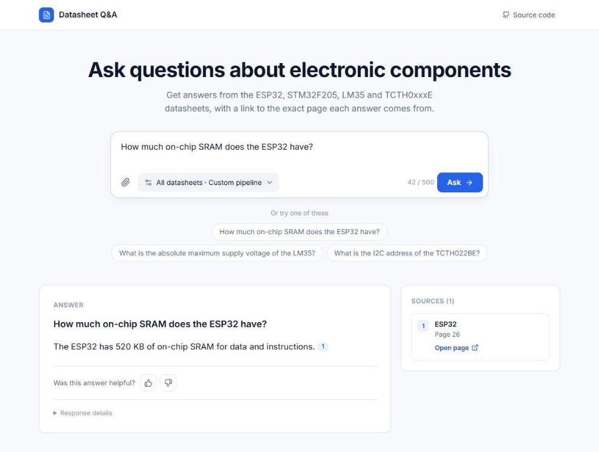
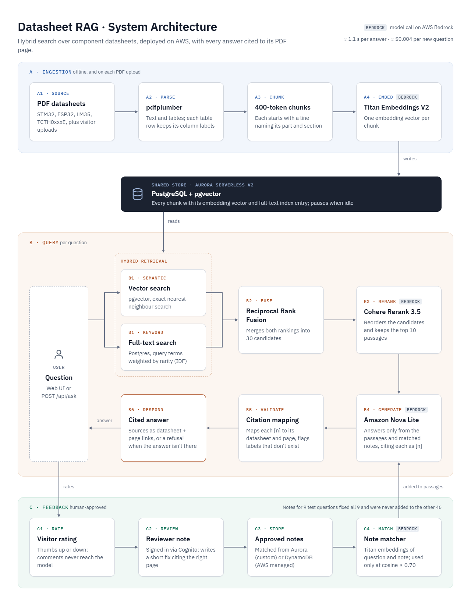
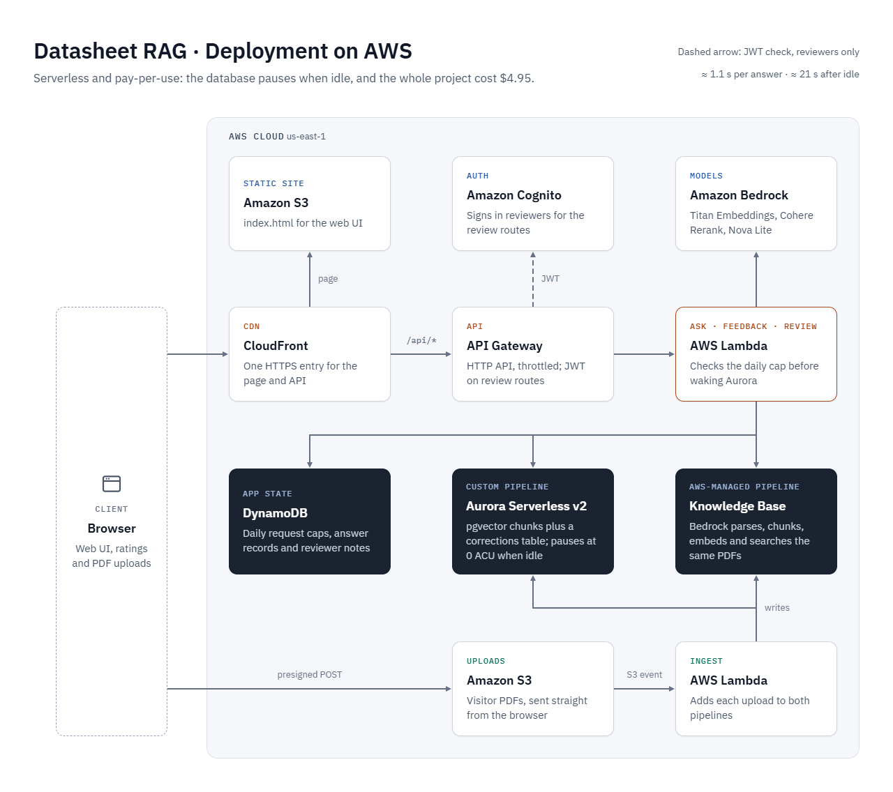

# Datasheet RAG: Question Answering with Page-Level Citations

A retrieval-augmented generation (RAG) system for electronic component datasheets. Every answer cites the PDF page behind it, and questions the datasheets cannot answer are refused instead of guessed.



**Status:** Built, deployed on AWS, and evaluated. Full methods and results are in [REPORT.md](REPORT.md).

## Overview

Built a retrieval-augmented generation system that answers questions about four electronic component datasheets and cites the PDF page behind every claim. Implemented hybrid retrieval that combines pgvector similarity search with Postgres full-text search, merged the rankings with Reciprocal Rank Fusion, and reranked the results with Cohere Rerank 3.5 before generating answers with Amazon Nova Lite. Deployed the pipeline on AWS with CloudFront, API Gateway, Lambda, and Aurora PostgreSQL Serverless v2, and compared it against an Amazon Bedrock Managed Knowledge Base on the same questions. Added a human-approved feedback loop, where reviewers turn wrong answers into short page-cited notes that correct them without affecting unrelated questions, and PDF upload so visitors can ask about their own documents.

**Datasheets covered:** STMicroelectronics STM32F205/207, Espressif ESP32, Texas Instruments LM35, Toshiba TCTH0xxxE.

## Results

Evaluated on 49 hand-checked questions, 43 with an answer in the datasheets and 6 without.

- Cited the correct page for 40 of 43 answerable questions and refused all 6 unanswerable ones.
- Reached a faithfulness score of 0.972 using RAGAS with Amazon Nova Pro as judge.
- Matched the local results when deployed on AWS, answering in about 1.1 seconds for roughly $0.004 per new question.
- Cost $4.95 in AWS charges for the whole project, including every evaluation run.

## Architecture



### Deployment on AWS



## Tech Stack

| Component | Technology |
|---|---|
| Language | Python 3.14 |
| Parsing and embeddings | pdfplumber, Amazon Titan Text Embeddings V2 |
| Database and retrieval | PostgreSQL with pgvector, Postgres full-text search, Reciprocal Rank Fusion |
| Reranking and generation | Cohere Rerank 3.5, Amazon Nova Lite (AWS Bedrock) |
| Evaluation | Recall@k, MRR, citation checks, RAGAS |
| AWS | Lambda, API Gateway, CloudFront, S3, Aurora Serverless v2, DynamoDB, Cognito, Bedrock Managed Knowledge Base |
| Testing | pytest, ruff, GitHub Actions CI |

## Custom Pipeline vs AWS Managed

Built a second pipeline on an Amazon Bedrock Managed Knowledge Base, where AWS parses, chunks, embeds, searches, and reranks the same four PDFs. Both pipelines used the same answer model, prompt, and citation check, so the comparison measures retrieval.

- **The custom pipeline retrieved better.** It cited the correct page for 40 of 43 questions against 36 for the managed pipeline, with the largest gap on table lookups and comparisons. Table-aware chunking and hybrid search kept values with their labels.
- **The managed pipeline was cheaper and faster to set up.** It cost about a third as much per question and took far less setup.

## Human-Approved Feedback Loop

Visitors rate each answer, and a reviewer signed in through Cognito turns a thumbs-down into a short note that cites the correct datasheet page. When a later question closely matches a note, the note is added to the passages the answer model sees. Matching compares Titan embeddings of the question and the note, and a note is used only when their cosine similarity is at least 0.70. Both pipelines use the same matcher. Visitor comments never reach the model, so only reviewers can change what the system says.

On the test set, notes written for 9 questions fixed all 9 of them on both pipelines and were not added to any of the other 46 questions.

## Limitations

- **Small test set.** 4 datasheets and 49 questions, so most gaps between setups are one or two questions.
- **False refusals.** On 2 of the 43 answerable questions, the model refused even though the answer was in the passages it received. Retrieval found the right page, so the cause is the answer model and not search.
- **Wrong page cited.** On 1 of the 43 answerable questions, the answer gave the correct value but cited the wrong page.
- **Cold starts.** Aurora pauses when idle to keep costs near zero, so the first question after a quiet period waits about 21 seconds while the database resumes. Later questions answer in about 1.1 seconds.

## Future Work

1. Test a stronger answer model to reduce false refusals.
2. Grow the question set and add datasheets, so small differences between setups can be measured.
3. Try fixed-size chunking in the Knowledge Base, to see how much of its gap comes from chunking.

## Getting Started

### Prerequisites

- Python 3.14
- Docker
- An AWS account with Bedrock access in `us-east-1` to `amazon.titan-embed-text-v2:0`, `cohere.rerank-v3-5:0`, and `amazon.nova-lite-v1:0`

### Datasheets

The PDFs are not included because of vendor copyright. Download them and save them in `datasheet-rag/data/pdfs/`.

| Datasheet | Link |
|---|---|
| STMicroelectronics STM32F205xx / STM32F207xx, DS6329 Rev 18 | [alldatasheet.com](https://www.alldatasheet.com/datasheet-pdf/pdf/451395/STMICROELECTRONICS/STM32F205XX.html) |
| Espressif ESP32 Series Datasheet, version 5.3 | [espressif.com](https://documentation.espressif.com/esp32_datasheet_en.pdf) |
| Texas Instruments LM35, SNIS159H | [ti.com](https://www.ti.com/lit/ds/symlink/lm35.pdf) |
| Toshiba TCTH0xxxE series, Rev. 2.0.A | [toshiba.semicon-storage.com](https://toshiba.semicon-storage.com/info/TCTH022BE_datasheet_en_20230425.pdf?did=149583&prodName=TCTH022BE) |

### Installation

The commands below are for Windows PowerShell and run from `datasheet-rag`.

```powershell
cd datasheet-rag
python -m venv .venv
.\.venv\Scripts\Activate.ps1
pip install -r requirements.txt

docker run -d --name rag-pg -e POSTGRES_PASSWORD=<your_db_password> -p 5432:5432 -v rag_pgdata:/var/lib/postgresql/data pgvector/pgvector:pg16
copy .env.example .env        # then put the same password in PGPASSWORD

python -m rag.parse           # PDFs -> runs/parsed/*.json
python -m rag.load            # prints the embedding calls and cost, changes nothing
python -m rag.load --run      # embeds and stores
```

To load only the setup the app uses, run `python -m rag.load --run --strategy fixed_400_prefix`.

### Usage

- **Web UI:** run `python -m rag.server`, then open http://127.0.0.1:8000.
- **Command line:** `python -m rag.pipeline "What is the absolute maximum supply voltage of the LM35?"`
- **Tests:** `pytest`
- **Evaluation:** `python -m rag.eval.run_eval --all --dry-run` prints the calls, cost, and time, then stops. Leave out `--dry-run` to run it.
