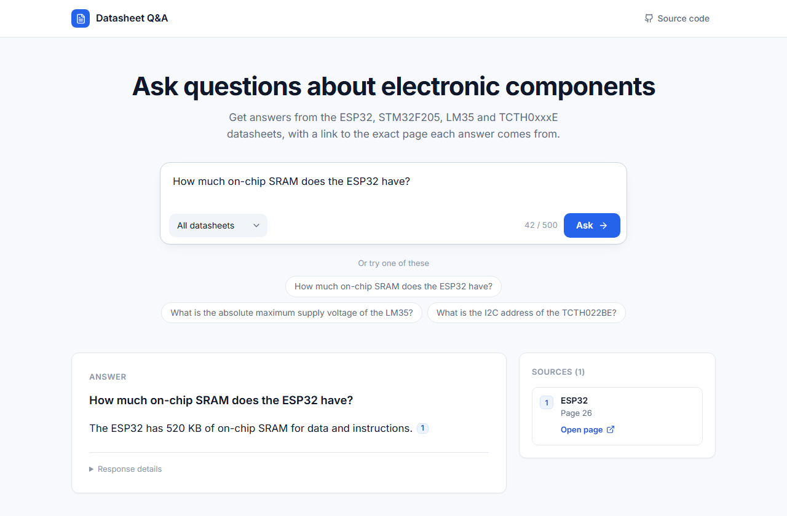
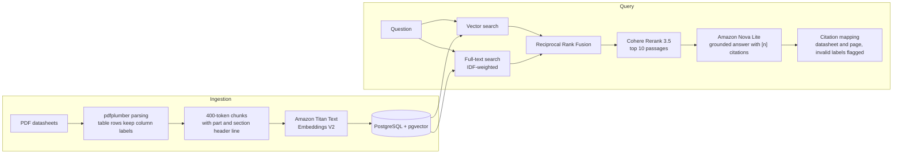

# Datasheet RAG: Question Answering with Page-Level Citations

A retrieval-augmented generation (RAG) system for electronic component datasheets. Every answer cites the PDF page behind it, and questions the datasheets cannot answer are refused instead of guessed.



**Status:** Local build complete and evaluated. Deployment on AWS is planned as the next phase.

## Contents

- [Overview](#overview)
- [Key Results](#key-results)
- [Architecture](#architecture)
- [Tech Stack](#tech-stack)
- [Evaluation](#evaluation)
- [Optimizations and Root-Cause Analysis](#optimizations-and-root-cause-analysis)
- [Metric Definitions](#metric-definitions)
- [Ground Truth](#ground-truth)
- [Failure Analysis](#failure-analysis)
- [Limitations](#limitations)
- [Future Work](#future-work)
- [Getting Started](#getting-started)

## Overview

Built a retrieval-augmented generation (RAG) system that answers questions about four electronic component datasheets and cites the PDF page behind every claim. Implemented hybrid retrieval that combines pgvector similarity search with Postgres full-text search, merged the rankings with Reciprocal Rank Fusion, and reranked the results with Cohere Rerank 3.5 before generating answers with Amazon Nova Lite. Evaluated the system on 49 hand-checked questions, where it cited the correct page for 40 of 43 answerable questions, refused all 6 unanswerable questions, and reached a recall@10 of 1.000 and a RAGAS faithfulness of 0.972. The full project, including every evaluation run, cost $2.23 in AWS calls.

**Datasheets covered:** STMicroelectronics STM32F205/207, Espressif ESP32, Texas Instruments LM35, Toshiba TCTH0xxxE.

## Key Results

Measured on 49 hand-checked questions: 43 with an answer in the datasheets and 6 without.

| Metric | Result |
|---|---|
| Correct page cited | 40 of 43 answerable questions |
| Unanswerable questions refused | 6 of 6, and no setup invented a value for any of them |
| Retrieval recall@10 | 1.000 (43 of 43) |
| Mean reciprocal rank (MRR@10) | 0.865 |
| Faithfulness (RAGAS, Amazon Nova Pro as judge) | 0.972 |
| Cost per question | About $0.0023 for a new question, $0.0003 for a repeated one |
| Latency | Search about 60 ms, reranking 0.3 s, answer generation 0.5 to 1.5 s |
| Total project cost | $2.23 in AWS calls, including every evaluation run |

## Architecture



Design decisions:

- **Table-aware parsing.** pdfplumber keeps each table row together with its column labels.
- **Contextual chunk headers.** Each chunk starts with a line naming its part and section before it is embedded.
- **Hybrid retrieval.** Vector search and keyword search run in parallel and are merged with Reciprocal Rank Fusion.
- **Grounded generation.** The answer model sees only the numbered passages and cites them as `[n]`.
- **Citation validation.** The code maps every `[n]` back to a datasheet and page and flags any label that does not exist.
- **Local execution.** The models run through AWS Bedrock, and a small Python server with a web page runs on one machine.

## Tech Stack

| Component | Technology |
|---|---|
| Language | Python 3.14 |
| PDF parsing | pdfplumber |
| Embeddings | Amazon Titan Text Embeddings V2 (AWS Bedrock) |
| Database and vector store | PostgreSQL with pgvector, run in Docker |
| Retrieval | pgvector similarity search, Postgres full-text search, Reciprocal Rank Fusion |
| Reranking | Cohere Rerank 3.5 (AWS Bedrock) |
| Answer generation | Amazon Nova Lite (AWS Bedrock) |
| Evaluation | Custom recall@k, MRR, and citation checks, plus RAGAS with Amazon Nova Pro as judge |
| Serving | Python server with a web UI and a JSON API |
| Testing | pytest |

## Evaluation

Every setup was run on the same 49 questions, changing one variable at a time from the baseline. The baseline uses 400-token chunks, hybrid search, the `english` full-text configuration, 30 candidates, and no datasheet filter. Recall@k and MRR are computed over the 43 answerable questions.

### Retrieval

| Setup | R@1 | R@5 | MRR@10 | R@1 reranked | R@5 reranked | MRR@10 reranked |
|---|---|---|---|---|---|---|
| Baseline (400-token chunks, hybrid) | 0.651 | 0.930 | 0.766 | 0.767 | 0.977 | 0.855 |
| Whole-page chunks | 0.488 | 0.837 | 0.651 | 0.674 | 0.860 | 0.767 |
| 256-token chunks | 0.651 | 0.930 | 0.767 | 0.744 | 0.953 | 0.834 |
| 256-token chunks, overlap | 0.628 | 0.930 | 0.748 | 0.744 | 0.930 | 0.841 |
| 400-token chunks, overlap | 0.651 | 0.907 | 0.765 | 0.744 | 0.953 | 0.843 |
| Structure-aware chunks | 0.651 | 0.953 | 0.770 | 0.744 | 0.977 | 0.844 |
| 1024-token chunks | 0.628 | 0.930 | 0.749 | 0.791 | 0.977 | 0.865 |
| Vector search only | 0.581 | 0.814 | 0.674 | 0.744 | 0.977 | 0.848 |
| Keyword search only | 0.512 | 0.860 | 0.665 | 0.791 | 0.977 | 0.874 |
| `simple` full-text config | 0.558 | 0.907 | 0.688 | 0.767 | 0.953 | 0.855 |
| Datasheet filter from the question | 0.651 | 0.930 | 0.774 | 0.791 | 0.977 | 0.871 |
| HNSW approximate index (vector only) | 0.581 | 0.814 | 0.674 | 0.744 | 0.977 | 0.848 |
| **Header line on each chunk (chosen)** | **0.767** | **0.953** | **0.834** | **0.767** | **0.977** | **0.865** |

The hierarchical navigable small world (HNSW) index found 99.5% of the exact nearest neighbours, and its results matched exact search. With about 800 chunks, the system uses exact search.

### Answer Quality

Answers generated by Amazon Nova Lite from reranked passages.

| Setup | Passages | Correct page cited | Answerable but refused | Faithfulness | Answer relevancy |
|---|---|---|---|---|---|
| **Header line (chosen)** | **10** | **40/43** | **2** | **0.972** | **0.859** |
| Header line | 5 | 37/43 | 6 | 0.862 | 0.789 |
| Header line | 3 | 34/43 | 7 | n/a | n/a |
| Datasheet filter | 5 | 37/43 | 6 | 0.853 | 0.791 |
| 1024-token chunks | 5 | 36/43 | 6 | n/a | n/a |
| Baseline | 5 | 36/43 | 7 | 0.831 | 0.780 |

RAGAS was run on the four best setups only.

## Optimizations and Root-Cause Analysis

### 1. Header line on each chunk

- **Problem:** Datasheet sections contain many near-identical tables, so a chunk gave the embedding no signal about which chip a row belongs to.
- **Solution:** Prepended the part name, datasheet, and section to each chunk before embedding.
- **Result:** The largest gain in search order of any change. MRR rose from 0.766 to 0.834 without the reranker, almost as much as the reranker adds on its own.

### 2. More passages for the answer model

- **Problem:** Retrieval was nearly solved with a recall@10 of 1.000, so the main failure became the model refusing questions whose answer was in its passages. The judge also found a wrong value: with 5 passages, the model reported the accuracy of the LM35A for the LM35, because only the LM35A table was in its context.
- **Solution:** Raised the number of passages sent to the answer model from 5 to 10.
- **Result:** False refusals dropped from 6 to 2, and the wrong LM35 value was fixed. The cost was about 2,000 extra input tokens per question, or $0.0001.

### 3. Refusal check bug

- **Problem:** The first evaluation run reported that only 67 to 83% of the unanswerable questions were refused.
- **Cause:** Reading the answers showed that the model had refused correctly but sometimes appended citation labels after the refusal sentence, such as "The provided datasheets do not contain this information. [1] [2] [3]". The check counted that as an answer.
- **Solution:** Fixed the refusal check. It now also counts a refusal as a miss in the citation score.
- **Result:** Every setup refused 6 of 6 unanswerable questions.

### 4. Rarity-weighted keyword ranking

- **Problem:** Plain Postgres `ts_rank` placed an STM32 table-of-contents page first for the question "TCTH022BE supply voltage".
- **Cause:** `ts_rank` weights every query word equally, so a rare part number counted no more than a common word such as "supply".
- **Solution:** Weighted each query word by how rare it is across the chunks, using BM25-style inverse document frequency (IDF).
- **Result:** A part number now counts for much more than a common word in the keyword ranking.

## Metric Definitions

- **recall@k:** the share of answerable questions with at least one correct `(datasheet, page)` pair in the top k passages. A question can list several acceptable pages.
- **MRR@10:** the mean over questions of 1 / rank of the first correct page, counted as 0 when no correct page is in the top 10.
- **Correct page cited:** the answer cites at least one page from the question's list of acceptable pages. A refusal counts as a miss.
- **Answerable but refused:** the model gave the "not contained" sentence for a question whose answer is in the datasheets.
- **Faithfulness (RAGAS):** the judge splits the answer into statements and checks each against the passages. The score is the share that are supported, so a wrong refusal scores 0.
- **Answer relevancy (RAGAS):** the judge writes the question the answer seems to reply to. The score is that question's cosine similarity with the real one, or 0 if the answer dodges.

## Ground Truth

The test set has 49 questions: 22 table lookups, 10 single values, 6 reworded questions that share few words with the datasheet, 5 comparisons across two datasheets, and 6 with no answer in any datasheet. Each question has an expected answer and the list of PDF pages that hold it.

- The questions were drafted with an AI assistant, and every answer and page was checked against the rendered PDF page before the set was frozen.
- The file's SHA-256 hash is pinned in the config, and a test fails if the file changes.
- The chunking was not tuned to individual questions.

## Failure Analysis

Results for the chosen chunking setup with reranking:

| Question type | Questions | R@5 | MRR@10 | Main failure |
|---|---|---|---|---|
| Single value | 10 | 1.000 | 0.950 | Refusals with the answer in the passages, fewer at 10 passages |
| Table lookup | 22 | 1.000 | 0.845 | Similar rows in neighbouring tables, so the right one is found but not always first |
| Reworded | 6 | 0.833 | 0.769 | "Five-volt-tolerant pin": the datasheet writes "FT" and "VDD + 4 V", so no words match |
| Comparison | 5 | 1.000 | 0.900 | Needs pages from two datasheets in one list, and recall counts one side as a hit |

## Limitations

- **Small test set.** 4 datasheets and 49 questions, so one question moves a score by 0.023. Most gaps between chunking setups are one or two questions.
- **Question verification.** The set was checked against the PDFs with an AI assistant, not by an independent annotator.
- **False refusals.** These are the main answer failure, at 2 of 43 questions with the chosen setup.
- **Wrong page cited.** One answer gave the right value but cited the wrong page. The faithfulness judge cannot see this, and only the citation check can.
- **Refusals in other words.** The model once refused in its own words ("Sorry, I cannot provide..."). The check looks for one fixed sentence, so it counted 5 of 6 refusals for the chosen setup where reading the answers gives 6 of 6.
- **Run-to-run variation.** Answers moved by one or two questions between identical runs, even at temperature 0.
- **Judge errors.** In 2 of 21 judged refusals, the judge's verdict contradicted its own reason. Judge scores are reported next to the citation check, not instead of it.
## Future Work

In order of expected gain:

1. Test a stronger answer model to reduce false refusals, now that retrieval finds the right page.
2. Grow the question set and add datasheets, so the chunking setups can be told apart.
3. Score comparison questions on both sides, requiring both datasheets' pages to be retrieved and cited.
4. Extend the refusal check to catch refusals written in other words.
5. Deploy the application on AWS.

## Getting Started

### Prerequisites

- Python 3.14
- Docker
- An AWS account with Bedrock access in `us-east-1` to `amazon.titan-embed-text-v2:0`, `cohere.rerank-v3-5:0`, and `amazon.nova-lite-v1:0`
- An AWS user with `bedrock:InvokeModel` and `bedrock:Rerank` permissions

### Datasheets

The PDFs are not included in this repository because of vendor copyright. Download them from the vendors and save them in `datasheet-rag/data/pdfs/` with these names:

| File | Datasheet |
|---|---|
| `DS_CD00237391.pdf` | STMicroelectronics STM32F205xx / STM32F207xx, DS6329 Rev 18 |
| `esp32_datasheet_en.pdf` | Espressif ESP32 Series Datasheet, version 5.3 |
| `lm35.pdf` | Texas Instruments LM35, SNIS159H |
| `TCTH022BE_datasheet_en_20230425.pdf` | Toshiba TCTH0xxxE series, Rev. 2.0.A |

### Installation

The commands below are for Windows PowerShell and run from `datasheet-rag`.

```powershell
cd datasheet-rag
python -m venv .venv
.\.venv\Scripts\Activate.ps1
pip install -r requirements.txt

docker run -d --name rag-pg -e POSTGRES_PASSWORD=<your_db_password> -p 5432:5432 -v rag_pgdata:/var/lib/postgresql/data pgvector/pgvector:pg16
copy .env.example .env        # then put the same password in PGPASSWORD

python -m rag.parse           # PDFs -> runs/parsed/*.json
python -m rag.load            # prints the embedding calls and cost, changes nothing
python -m rag.load --run      # embeds and stores (about $0.02)
```

The full load embeds every chunking setup and takes about 45 minutes. To load only the setup the app uses, run `python -m rag.load --run --strategy fixed_400_prefix`.

### Usage

- **Web UI:** run `python -m rag.server`, then open http://127.0.0.1:8000.
- **Command line:** `python -m rag.pipeline "What is the absolute maximum supply voltage of the LM35?"`
- **Tests:** `pytest`. The tests make no AWS calls.
- **Evaluation:** `python -m rag.eval.run_eval --all --dry-run` prints the calls, cost, and time, then stops. Leave out `--dry-run` to run the evaluation.

### API

| Endpoint | Description |
|---|---|
| `POST /api/ask` | Takes `{"question": "...", "document": null}` and returns the answer, its sources (datasheet, page, PDF link), and the time and cost |
| `GET /api/documents` | Lists the datasheets |

## Further Documentation

Detailed write-ups of each step are in `datasheet-rag/runs/`. They cover parsing, search, reranking, the evaluation, and the RAGAS judge, and `cycle1_summary.md` brings them together.
