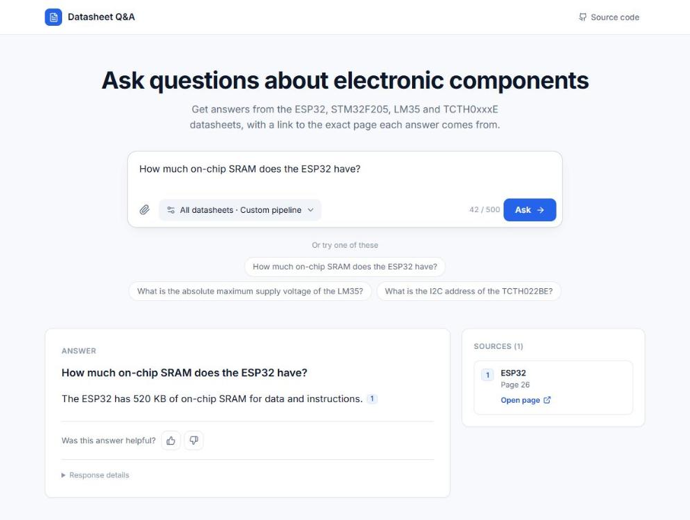
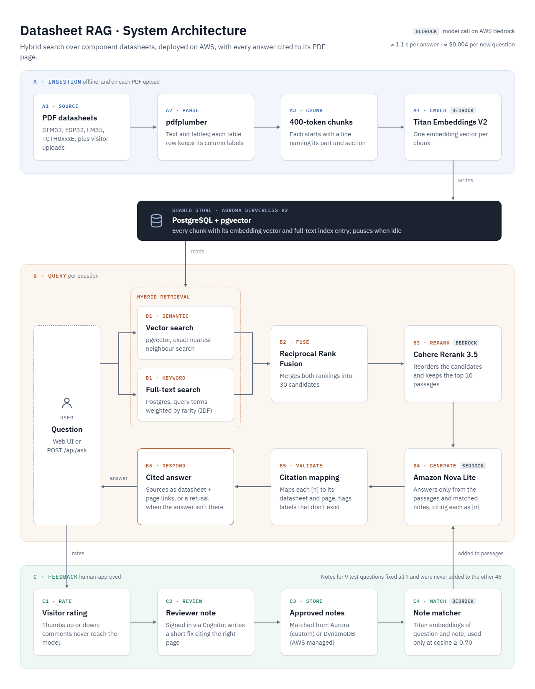
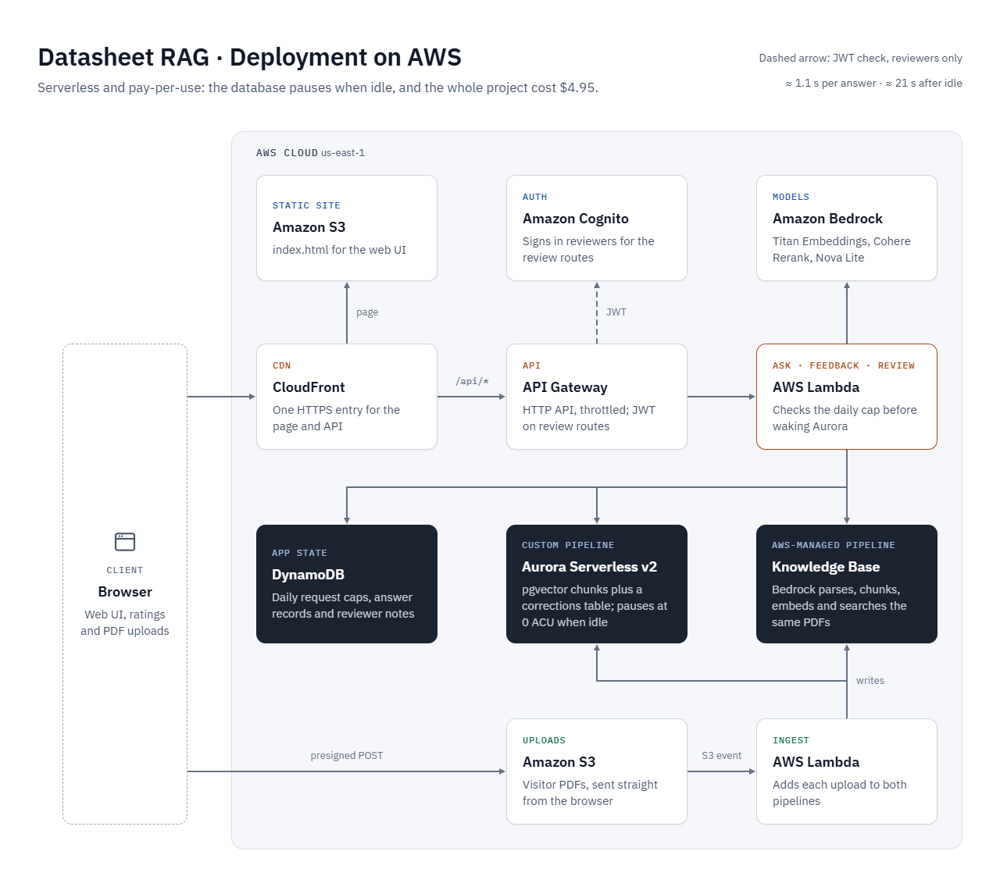

# Datasheet RAG: Evaluation Report

This report covers the whole project: the local pipeline and how its setup was chosen, the deployment on AWS, the comparison with an AWS-managed pipeline, PDF upload, and the human-approved feedback loop. The README gives the short version. The detailed write-up behind each section is linked at its end, and every number comes from the files in [`datasheet-rag/runs/`](datasheet-rag/runs/).

## Contents

- [Summary](#summary)
- [Web Interface](#web-interface)
- [System](#system)
- [Question Set and Metrics](#question-set-and-metrics)
- [Choosing the Setup](#choosing-the-setup)
- [Deployed Evaluation](#deployed-evaluation)
- [Custom Pipeline vs AWS Managed](#custom-pipeline-vs-aws-managed)
- [PDF Upload](#pdf-upload)
- [Human-Approved Feedback Loop](#human-approved-feedback-loop)
- [Failure Analysis](#failure-analysis)
- [Cost](#cost)
- [Optimizations and Root-Cause Analysis](#optimizations-and-root-cause-analysis)
- [What I Learned](#what-i-learned)
- [Limitations](#limitations)
- [Future Work](#future-work)

## Summary

Built a retrieval-augmented generation (RAG) system that answers questions about four electronic component datasheets and cites the PDF page behind every claim. Designed the pipeline locally, choosing its setup from 12 retrieval experiments and a RAGAS judge, then deployed it on AWS with CloudFront, API Gateway, Lambda, and Aurora PostgreSQL Serverless v2 with pgvector. Built a second pipeline on an Amazon Bedrock Managed Knowledge Base behind the same page and compared the two on the same 49 hand-checked questions: the custom pipeline cited the correct page for 40 of 43 answerable questions against 36 for the managed one, at about three times the cost per new question. Added PDF upload and a human-approved feedback loop to both pipelines; three reviewer notes fixed every one of their 9 target questions with no note leaking to the other 46.

| Metric | Result |
|---|---|
| Correct page cited, deployed | 40 of 43 (custom), 36 of 43 (AWS managed) |
| Correct page cited, with reviewer notes | 42 of 43 (custom), 38 of 43 (AWS managed) |
| Unanswerable questions refused | 6 of 6 on both pipelines, in every run |
| Retrieval recall@10 / mean reciprocal rank (MRR@10) | 1.000 / 0.865 (custom), 0.930 / 0.800 (AWS managed) |
| Faithfulness (RAGAS, Amazon Nova Pro as judge) | 0.972 (custom, chosen setup) |
| Latency, median, deployed | 1.09 s (custom), 1.66 s (AWS managed) |
| Latency, cold start | About 21 s, 18 s of it Aurora resuming from a pause |
| Cost per new question, deployed | About $0.0041 (custom, with Aurora), $0.0012 (AWS managed) |
| Feedback loop | Target questions fixed: 0 of 9 before, 9 of 9 after, on both pipelines |
| Total project cost | $4.95 in AWS charges, including the deployment and every evaluation run |
| Tests | 1,344 pytest tests, ruff, GitHub Actions CI |

## Web Interface

One static page serves both pipelines. Each answer cites its sources as numbered badges, each source card opens the datasheet at the cited page, and every answer can be rated. The options button picks a datasheet and switches between the custom pipeline and the AWS-managed one, and the paperclip uploads a PDF to ask about.

## System

### Custom Pipeline

- **Parsing.** pdfplumber reads text and tables page by page and keeps each table row with its column labels.
- **Chunking.** 400-token chunks that never cross a page. Each table row becomes one line, `Label: value, Label: value`.
- **Contextual chunk headers.** Each chunk is embedded with a line naming its part, datasheet, and section.
- **Embeddings.** Amazon Titan Text Embeddings V2, 1024 dimensions, stored in Postgres with pgvector.
- **Hybrid retrieval.** Exact vector search and Postgres full-text search with rarity-weighted keywords, merged with Reciprocal Rank Fusion into 30 candidates.
- **Reranking.** Cohere Rerank 3.5 keeps the best 10.
- **Generation.** Amazon Nova Lite at temperature 0 answers only from the numbered passages and cites them as `[n]`.
- **Citation validation.** The code maps every `[n]` back to a datasheet and PDF page and flags any label that does not exist.
- **Caching.** Every paid embedding and rerank score is stored, so a repeated question costs only the answer.

### AWS-Managed Pipeline

- **Knowledge Base.** An Amazon Bedrock Managed Knowledge Base parses, chunks, embeds, searches, and reranks the same four PDFs.
- **Same answer step.** Its top 10 passages go to the same generation and citation code as the custom pipeline, so any difference between the two comes from retrieval.

### Deployment

- **One origin.** CloudFront serves the page from a private S3 bucket and sends `/api/*` to API Gateway, so the page needs no CORS setup.
- **No VPC.** Aurora's express configuration is reached over the internet with an IAM token and TLS, so Lambda needs no NAT gateway.
- **Pay when used.** Aurora pauses at 0 Aurora capacity units (ACU) after 5 idle minutes. DynamoDB and Lambda bill per request.
- **Cost guards.** Every request is checked, and counted against a daily cap in DynamoDB, before anything wakes Aurora. A Lambda variable switches the demo off.
- **Reviewers.** The review endpoints sit behind a Cognito JWT authorizer, plus a group check in the Lambda.

Details: [`lambda_deploy.md`](datasheet-rag/runs/lambda_deploy.md), [`api_gateway.md`](datasheet-rag/runs/api_gateway.md), [`frontend_deploy.md`](datasheet-rag/runs/frontend_deploy.md), [`kb_setup.md`](datasheet-rag/runs/kb_setup.md).

## Question Set and Metrics

### Ground Truth

The test set has 49 questions: 22 table lookups, 10 single values, 6 reworded questions that share few words with the datasheet, 5 comparisons across two datasheets, and 6 with no answer in any datasheet. Each question has an expected answer and the list of PDF pages that hold it.

- The questions were drafted with an AI assistant, and every answer and page was checked against the rendered PDF pages.
- The set was frozen before the final setup was chosen, and a test fails if the file changes.
- The chunking was not tuned to individual questions.

### Metric Definitions

- **recall@k:** the share of answerable questions with at least one correct `(datasheet, page)` pair in the top k passages. One question is worth 0.023.
- **MRR@10:** the mean over questions of 1 / rank of the first correct page, counted as 0 when no correct page is in the top 10.
- **Correct page cited (citation hit):** the answer cites at least one page from the question's list. A refusal counts as a miss.
- **Answerable but refused:** the model refused a question whose answer is in the datasheets.
- **Faithfulness (RAGAS):** the share of the answer's statements that the passages support, as judged by Amazon Nova Pro.
- **Answer relevancy (RAGAS):** how closely the question the judge infers from the answer matches the real question.

## Choosing the Setup

Every setup was run on the same 49 questions, changing one variable at a time from the baseline: 400-token chunks, hybrid search, the `english` full-text configuration, 30 candidates, and no datasheet filter.

### Retrieval

| Setup | R@1 | R@5 | MRR@10 | R@1 reranked | R@5 reranked | MRR@10 reranked |
|---|---|---|---|---|---|---|
| Baseline (400-token chunks, hybrid) | 0.651 | 0.930 | 0.766 | 0.767 | 0.977 | 0.855 |
| Whole-page chunks | 0.488 | 0.837 | 0.651 | 0.674 | 0.860 | 0.767 |
| 256-token chunks | 0.651 | 0.930 | 0.767 | 0.744 | 0.953 | 0.834 |
| 256-token chunks, overlap | 0.628 | 0.930 | 0.748 | 0.744 | 0.930 | 0.841 |
| 400-token chunks, overlap | 0.651 | 0.907 | 0.765 | 0.744 | 0.953 | 0.843 |
| Structure-aware chunks | 0.651 | 0.953 | 0.770 | 0.744 | 0.977 | 0.844 |
| 1024-token chunks | 0.628 | 0.930 | 0.749 | 0.791 | 0.977 | 0.865 |
| Vector search only | 0.581 | 0.814 | 0.674 | 0.744 | 0.977 | 0.848 |
| Keyword search only | 0.512 | 0.860 | 0.665 | 0.791 | 0.977 | 0.874 |
| `simple` full-text config | 0.558 | 0.907 | 0.688 | 0.767 | 0.953 | 0.855 |
| Datasheet filter from the question | 0.651 | 0.930 | 0.774 | 0.791 | 0.977 | 0.871 |
| HNSW approximate index (vector only) | 0.581 | 0.814 | 0.674 | 0.744 | 0.977 | 0.848 |
| **Header line on each chunk (chosen)** | **0.767** | **0.953** | **0.834** | **0.767** | **0.977** | **0.865** |

### Answer Quality

| Setup | Passages | Correct page cited | Answerable but refused | Faithfulness | Answer relevancy |
|---|---|---|---|---|---|
| **Header line (chosen)** | **10** | **40/43** | **2** | **0.972** | **0.859** |
| Header line | 5 | 37/43 | 6 | 0.862 | 0.789 |
| Header line | 3 | 34/43 | 7 | n/a | n/a |
| Datasheet filter | 5 | 37/43 | 6 | 0.853 | 0.791 |
| 1024-token chunks | 5 | 36/43 | 6 | n/a | n/a |
| Baseline | 5 | 36/43 | 7 | 0.831 | 0.780 |

RAGAS was run on the four best setups only, because each judged answer costs several Nova Pro calls.

### Why This Setup

- **Header line.** The largest gain in search order of any change: MRR 0.766 to 0.834 without the reranker.
- **10 passages instead of 5.** False refusals fell from 6 to 2 for $0.0001 more per question.
- **Reranker on.** It lifts every setup to R@5 0.977.
- **Hybrid search.** Vector and keyword search miss different questions, and together reach R@5 0.930 without the reranker, against 0.814 and 0.860 alone.
- **Exact search.** The HNSW index found 99.5% of the exact nearest neighbours, which is not needed at about 800 chunks.

Details: [`cycle1_summary.md`](datasheet-rag/runs/cycle1_summary.md), [`eval_review.md`](datasheet-rag/runs/eval_review.md), [`ragas_review.md`](datasheet-rag/runs/ragas_review.md).

## Deployed Evaluation

The 49 questions were sent to the live site, 21 seconds apart, once with new questions (real rerank calls), once repeated (cached), and three times after 10 idle minutes (cold).

| | New question | Repeated question | Cold start |
|---|---|---|---|
| Correct page cited | 40/43 | 41/43 | 3/3 |
| Unanswerable refused | 6/6 | 6/6 | n/a |
| Client latency p50 / p90 | 1,088 / 1,331 ms | 827 / 1,013 ms | 21,408 / 21,617 ms |
| Lambda duration p50 | 911 ms | 645 ms | 19,425 ms |
| Database connect p50 | 119 ms | 129 ms | 17,574 ms |
| Search / rerank / answer p50 | 30 / 259 / 462 ms | 30 / 3 / 466 ms | 950 / 42 / 525 ms |
| Cost per question | $0.0041 | $0.0022 | $0.0024 |

- **The deployed pipeline answers like the local one.** It has the same citation hit rate, the same two false refusals, and no invalid labels.
- **Cold starts stay inside the limit.** Aurora's resume is about 18 of the 21 seconds, under API Gateway's 30-second limit.
- **Nova Lite is not fully repeatable.** Two passes with identical rerank scores gave different answers to 2 questions, even at temperature 0.
- **The reranker's real latency is about 260 ms.** The local evaluation never measured it, because its scores were cached.

Details: [`deployed_eval.md`](datasheet-rag/runs/deployed_eval.md), [`results_deployed.csv`](datasheet-rag/runs/results_deployed.csv).

## Custom Pipeline vs AWS Managed

The question: build your own RAG pipeline, or let AWS handle it? Both pipelines used the same 49 questions, the same answer model, prompt, and citation check, and the same metrics code.

| | Custom pipeline | AWS managed |
|---|---|---|
| R@1 | 0.767 | 0.744 |
| R@5 | 0.977 | 0.860 |
| R@10 | 1.000 | 0.930 |
| MRR@10 | 0.865 | 0.800 |
| Correct page cited | 40/43 | 36/43 |
| Answerable but refused | 2 | 4 (deployed), 3 (local) |
| Unanswerable refused | 6/6 | 6/6 |
| Client latency p50, deployed | 1,088 ms | 1,662 ms |
| Retrieval p50, deployed | 289 ms (search and rerank) | 969 ms |
| Cost per new question | $0.0041 ($0.0022 models, $0.0019 Aurora) | $0.0012 |
| Cost per repeated question | $0.0022 | $0.0012 (no cache) |
| Build effort | Parsing, table chunking, storage, hybrid search, and reranking, written and tested by hand | About an hour of console setup plus one API call |

Recall@5 by question type:

| Question type | Custom pipeline | AWS managed |
|---|---|---|
| Single value | 1.000 | 1.000 |
| Table lookup | 1.000 | 0.864 |
| Reworded | 0.833 | 0.833 |
| Comparison | 1.000 | 0.600 |

- **The custom pipeline retrieves better on tables and comparisons.** Its row-per-line table chunks keep each value with its label, and its candidate list keeps passages from both datasheets in a comparison. The managed search often filled the top 10 with one datasheet.
- **Answers follow retrieval.** All 4 questions that only the custom pipeline answered correctly were table lookups or comparisons.
- **The managed pipeline is cheaper and simpler to run.** It has no reranker quota, no database to wake, and no cache to maintain.
- **Managed page numbers have gaps.** 7 of 490 managed passages, all from the ESP32 datasheet, came back without a page number and could not be cited to a page.

Details: [`kb_compare.md`](datasheet-rag/runs/kb_compare.md).

## PDF Upload

A visitor can upload a PDF, wait for it to be indexed, and ask about it on either pipeline.

- **Flow.** The page uploads straight to S3 with a presigned POST. The S3 event starts an ingest Lambda that parses, chunks, and embeds the file into Aurora, then syncs it into the Knowledge Base.
- **Limits.** 10 MB, 100 pages, 300 chunks, 5 uploads a day, deleted after 24 hours. S3 itself refuses a larger file.
- **Isolation.** An upload is searched only when its private ID is sent with the question. The curated search never reads uploads, and the Knowledge Base search filters on its data source.
- **Speed.** A 37-page PDF was ready on the custom pipeline in under 2 minutes and on the managed one 3.5 minutes later.

| Case | With the upload ID? | Expected | Custom pipeline | AWS managed |
|---|---|---|---|---|
| Who introduced the actor model, and when? | Yes | Cite page 8 | Pass | Pass |
| What did Oliver Selfridge introduce in 1959? | Yes | Cite page 18 | Pass | Pass |
| LM35 supply voltage | Yes | Refuse | Pass | Pass |
| Who introduced the actor model? | No | Refuse (isolation) | Pass | Pass |

Details: [`upload_setup.md`](datasheet-rag/runs/upload_setup.md), [`retest_9c.md`](datasheet-rag/runs/retest_9c.md).

## Human-Approved Feedback Loop

A visitor can rate an answer. A reviewer reads each thumbs-down, diagnoses it, and can publish a short note that cites a datasheet page. Visitor comments never reach the model; only reviewer-written notes do.

- **Flow.** Thumbs-down → review queue → diagnosis (correct, not in the datasheets, retrieval miss, misread, false refusal) → note with a datasheet, page, and text → publish or retract.
- **Matching.** A note is added to a question's passages when the cosine similarity of their Titan embeddings is at least 0.70. Both pipelines use the same matcher.
- **Why not the Knowledge Base's own scores.** Its reranker scores only order passages for one question: an unrelated question scored 0.476 against a note while the note's own question scored 0.441. A note needs a yes-or-no decision, which needs a score that means the same for every question.
- **Notes published.** Three, one per known failure: q08 (misread LM35 accuracy), q24 (false refusal on the ESP32 DACs), q33 (false refusal on 5-volt-tolerant STM32 pins).

### Correction Cases

12 cases per pipeline: the 3 original questions, 6 paraphrases, and 3 negatives that are close in topic but must not get a note.

| | Custom: before | Custom: after | AWS managed: before | AWS managed: after |
|---|---|---|---|---|
| Originals passed | 0/3 | 3/3 | 0/3 | 3/3 |
| Paraphrases passed | 2/6 | 6/6 | 1/6 | 6/6 |
| Negatives passed, no note | 3/3 | 3/3 | 3/3 | 3/3 |

### Regression Check on the 49 Questions

| | Custom: before notes | Custom: with notes | AWS managed: before notes | AWS managed: with notes |
|---|---|---|---|---|
| Correct page cited | 41/43 | 42/43 | 36/43 | 38/43 |
| Answerable but refused | 2 | 0 | 4 | 1 |
| Unanswerable refused | 6/6 | 6/6 | 6/6 | 6/6 |
| Questions given a note | n/a | q08, q24, q33 only | n/a | q08, q24, q33 only |

- **Notes reached only their own questions.** The closest other question scored 0.605 against a note, under the 0.70 line.
- **Retracting works.** With the q24 note retracted, q24 was refused again on both pipelines, as before the note.

Details: [`feedback_eval.md`](datasheet-rag/runs/feedback_eval.md), [`retest_9c.md`](datasheet-rag/runs/retest_9c.md).

## Failure Analysis

Custom pipeline, chosen setup, reranked:

| Question type | Questions | R@5 | MRR@10 | Main failure |
|---|---|---|---|---|
| Single value | 10 | 1.000 | 0.950 | Refusals with the answer in the passages, fewer at 10 passages |
| Table lookup | 22 | 1.000 | 0.845 | Similar rows in neighbouring tables, so the right one is found but not always first |
| Reworded | 6 | 0.833 | 0.769 | "Five-volt-tolerant pin": the datasheet writes "FT" and "VDD + 4 V", so no words match |
| Comparison | 5 | 1.000 | 0.900 | Needs pages from two datasheets in one list, and recall counts one side as a hit |
| No answer | 6 | n/a | n/a | None: no setup invented a value |

- **False refusals** are the main answer failure on both pipelines: q24 and q33 on the custom pipeline before the notes.
- **Wrong value from a near-identical table.** With 5 passages, q08 reported the LM35A's accuracy for the LM35. The RAGAS judge caught it; the citation check did not, because the page was right.
- **Wrong page cited.** q22 gave the right value but cited the wrong page. The judge cannot see this; only the citation check can.
- **Run-to-run variation.** Between identical passes, 1 to 3 questions changed, from Nova Lite and, on the managed side, from the Knowledge Base's search.

## Cost

### Per Question, Deployed

| | Custom: new | Custom: repeated | AWS managed |
|---|---|---|---|
| Bedrock models | $0.00219 | $0.00027 | $0.00120 |
| Lambda | $0.000009 | $0.000006 | $0.000013 |
| API Gateway | $0.000001 | $0.000001 | $0.000001 |
| Aurora (spread over the run) | $0.00192 | $0.00192 | $0 |
| **Total** | **$0.0041** | **$0.0022** | **$0.0012** |

- **Aurora costs as much as the models at demo traffic.** Each wake-up keeps it at 0.5 to 2 ACU for at least 5 minutes, however few questions come in.
- **The reranker is 90% of the custom pipeline's model cost** for a new question ($0.002 of $0.0022).

### Total Spend

| Phase | Spend |
|---|---|
| Local pipeline and every evaluation run, including RAGAS | $2.25 |
| Deployment, deployed evaluations, AWS-managed pipeline, upload, and feedback loop (model calls) | About $0.60 |
| Aurora during the deployed evaluation | $0.19 |
| **All AWS charges, from Billing** | **$4.95** |

The rows above are the parts that were measured. The Billing total also includes Aurora outside the deployed evaluation, Knowledge Base storage, S3, Lambda, DynamoDB, Cognito, and CloudWatch.

Details: [`cost_log.csv`](datasheet-rag/runs/cost_log.csv), [`deployed_eval.md`](datasheet-rag/runs/deployed_eval.md), [`cost_fix.md`](datasheet-rag/runs/cost_fix.md).

## Optimizations and Root-Cause Analysis

### 1. Header line on each chunk

- **Problem:** Datasheet sections contain many near-identical tables, so a chunk gave the embedding no signal about which chip a row belongs to.
- **Solution:** Prepended the part name, datasheet, and section to each chunk before embedding.
- **Result:** The largest gain in search order of any change. MRR rose from 0.766 to 0.834 without the reranker.

### 2. More passages for the answer model

- **Problem:** Retrieval was nearly solved, so the main failure became the model refusing questions whose answer was in its passages.
- **Solution:** Raised the number of passages sent to the answer model from 5 to 10.
- **Result:** False refusals dropped from 6 to 2, and the wrong LM35 value was fixed, for $0.0001 more per question.

### 3. Rarity-weighted keyword ranking

- **Problem:** Plain Postgres `ts_rank` placed an STM32 table-of-contents page first for the question "TCTH022BE supply voltage".
- **Cause:** `ts_rank` weights every query word equally, so a rare part number counted no more than "supply".
- **Solution:** Weighted each query word by its BM25-style inverse document frequency.
- **Result:** A part number now dominates the keyword ranking.

### 4. Refusals in other words

- **Problem:** The refusal check counted 5 of 6 unanswerable questions as refused for the chosen setup, and the managed pipeline's refusal of an upload question was scored as an answer.
- **Cause:** The check looked for one fixed sentence, and the model sometimes refused in its own words, such as "Sorry, I cannot find a relevant answer in the given context."
- **Solution:** An uncited answer that says information is missing and refers to the datasheets, passages, or context also counts as a refusal. Every saved answer was re-scored.
- **Result:** 6 of 6 for every run. Only the two misjudged answers changed.

### 5. Database woken by requests that would never be answered

- **Problem:** Anyone could keep Aurora awake, at up to $11.52 a day, and the daily cap did not stop it.
- **Cause:** The Lambda connected to Aurora before checking the request, and the daily cap itself was counted in Aurora.
- **Solution:** Checked the route, body, question, and daily cap before connecting; moved the cap to DynamoDB; removed an unused route; added an off switch.
- **Result:** Every refused request answered in under 0.3 seconds, and Aurora's capacity stayed at 0.

### 6. One note matcher for both pipelines

- **Problem:** Reviewer notes stored in the Knowledge Base were never matched, or matched the wrong questions.
- **Cause:** The Knowledge Base's scores rank passages within one question and have no fixed scale across questions.
- **Solution:** Stored each note's Titan vector in DynamoDB and matched both pipelines by cosine similarity at 0.70.
- **Result:** All 9 target questions got their note on both pipelines, and none of the other 46 did.

### 7. Retract during an Aurora pause

- **Problem:** Retracting a note returned an error and left the note live on the custom pipeline, with no way to finish.
- **Cause:** Aurora was paused, and the connection timed out after the note's record had already changed.
- **Solution:** A retract that cannot reach the database removes the note from the managed side, marks it as retracting, and can be finished by retracting again.
- **Result:** The retract was finished, and q24 was refused again on both pipelines, as before its note.

## What I Learned

- **Fix retrieval first, then look at the answers.** Once recall@10 reached 1.000, every remaining failure was the answer model's: refusals, a misread table, a wrong citation.
- **Tables decide datasheet RAG.** The biggest gaps against the managed pipeline were table lookups and comparisons, which depend on how tables are chunked.
- **An LLM judge is one signal among several.** RAGAS caught a wrong value that the citation check missed, missed a wrong citation that the check caught, and contradicted its own reasoning on 2 of 21 refusals.
- **Managed is cheaper to run; custom is better to tune.** The Knowledge Base cost a third as much per question and took an hour to set up, but it could not be changed where it failed.
- **A serverless database costs by wake-up, not by question.** Aurora's pause saved the most money, but it also made the cold start 21 seconds and opened a way to keep it awake.
- **Account quotas shape the design.** A new account allowed 3 rerank calls a minute, which set the API's throttle and made caching necessary.
- **A reranker score is not a threshold.** It orders passages for one question and cannot decide whether a note fits.

## Limitations

- **Small test set.** 4 datasheets and 49 questions, so one question moves a score by 0.023, and most gaps between chunking setups are one or two questions.
- **Question verification.** The set was checked against the PDFs with an AI assistant, not by an independent annotator.
- **Answer model variation.** Nova Lite answered 1 to 3 questions differently between identical runs at temperature 0.
- **Rerank quota.** The account allows 3 rerank calls a minute for every visitor together, so the public demo was throttled to match.
- **Cold starts.** The first question after Aurora pauses waits about 21 seconds.
- **Note matching margin.** The 0.70 line separates the 12 correction cases by about 0.03 on each side; more notes need more cases.
- **Uploads.** Chunking rules were tuned on these four datasheets, and the managed sync once took over 15 minutes for an unknown reason.

## Future Work

In order of expected gain:

1. Test a stronger answer model to reduce false refusals, now that retrieval finds the right page.
2. Grow the question set and add datasheets, so chunking setups and the note threshold can be told apart.
3. Score comparison questions on both sides, requiring both datasheets' pages to be retrieved and cited.
4. Try fixed-size chunking in the Knowledge Base and RAGAS on its answers, to see how much of the gap is chunking.
5. Keep a small warm Aurora capacity during demos to remove the 21-second cold start.
